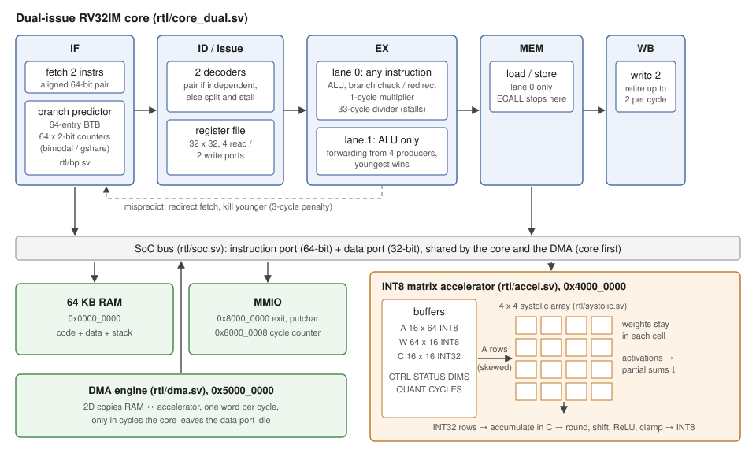

# RISC-V dual-issue core + INT8 matrix accelerator

An in-order **dual-issue superscalar RV32IM** processor with a branch predictor,
and a memory-mapped **INT8 systolic-array accelerator** for neural-network
layers. Written in SystemVerilog, checked instruction by instruction against a
reference model, and run through the official riscv-tests on every push.



## Results

| | |
| --- | --- |
| ISA | RV32IM (base integer + multiply/divide) |
| Cores | single-cycle (reference model), 5-stage pipeline, dual-issue 5-stage |
| riscv-tests | 48 / 48 (rv32ui + rv32um) on both pipelines, Icarus and Verilator |
| Dual-issue IPC | 1.13 on `bench.c` (5-stage pipeline: 0.81), **1.40x faster** |
| Branch predictor | fetch redirects cut from 58% to 17% of branches |
| Accelerator | 2-layer INT8 neural net **16.7x faster** than software on the dual-issue core, bit-exact |
| FPGA timing (Lattice ECP5-85F) | 5-stage 43.9 MHz, dual-issue 36.4 MHz (core logic, memories excluded) |
| Synthesis (Yosys, generic cells) | 5-stage 15.5k cells, dual-issue 31.7k, systolic array 10.6k; no latches |
| Verification | 6 unit testbenches (~190k checks), lockstep checking on every program, 5 directed assembly suites |

### Performance on `bench.c` (CRC-32, insertion sort, recursive Fibonacci, 18,024 instructions)

| Core | Cycles | IPC | Branches that redirect fetch |
| --- | ---: | ---: | ---: |
| 5-stage pipeline (predict not-taken) | 22,345 | 0.81 | 58.4% |
| Dual-issue + bimodal predictor | 15,932 | 1.13 | 17.1% |

### Accelerator: `mlp.c`, a 2-layer INT8 network (16 x 64 → 16 → 16)

| Core | Software | Accelerator | Speedup |
| --- | ---: | ---: | ---: |
| Single-cycle | 151,774 cycles | 8,075 | 18.7x |
| 5-stage | 193,762 | 9,617 | 20.1x |
| Dual-issue | 131,331 | 7,819 | 16.7x |

The array itself is busy for only 2,160 of those cycles; the rest is the core
copying matrices in and out with loads and stores (Amdahl's law). A DMA engine
is the next step.

### Timing: where the clock period goes

`make fmax` places and routes a core on a Lattice ECP5 with nextpnr. Both
cores have flip-flops on every input and output (`fpga/fmax_top.sv`), so the
number is the core's own slowest path; real block RAM would add its own
constraints.

| Core | Max clock | LUT4s | DSP blocks | Slowest path |
| --- | ---: | ---: | ---: | --- |
| 5-stage | 43.9 MHz | 3,716 | 4 | forwarding mux → 33x33 multiplier → result mux |
| Dual-issue | 36.4 MHz | 12,658 | 4 | forwarding mux → lane-0 ALU → branch redirect → fetch and stall control |

Both paths are the price of doing more in one EX cycle. The fixes are known
trade-offs: a 2-stage multiplier, and registering the branch redirect (one
more cycle per mispredict, which the predictor makes rare).

## Design highlights

**Dual-issue core** ([rtl/core_dual.sv](rtl/core_dual.sv))
- Fetches an aligned pair of instructions per cycle. Lane 0 runs anything;
  lane 1 runs ALU instructions only, which covers most pairs at a fraction of
  the cost of two full lanes.
- Issue logic splits a pair (and stalls the younger one) on a dependency
  inside the pair, a load-use hazard, or a non-ALU second instruction.
- Forwarding from four producers (two lanes x MEM/WB); the youngest wins.
- Precise stops: ECALL or an illegal instruction stops at MEM, and nothing
  younger retires.

**Branch predictor** ([rtl/bp.sv](rtl/bp.sv))
- 64-entry BTB (one entry per fetch pair) plus 64 two-bit counters, looked up
  in IF. Bimodal by default; gshare is a parameter.
- Mispredictions (wrong direction or wrong target) are caught in EX and cost
  2 cycles.

**Multiply / divide** ([rtl/mul_unit.sv](rtl/mul_unit.sv), [rtl/div_unit.sv](rtl/div_unit.sv))
- Single-cycle 33x33 multiplier (one signed multiply covers MUL, MULH,
  MULHSU and MULHU); a 1-bit-per-cycle restoring divider that stalls the
  pipeline for 33 cycles. Divides are rare, so a fast divider wasn't worth the area.

**Accelerator** ([rtl/accel.sv](rtl/accel.sv), [rtl/systolic.sv](rtl/systolic.sv))
- 4x4 weight-stationary systolic array: weights stay in the cells, activations
  flow right, partial sums flow down. Every value moves one cell per cycle,
  so there are no long wires and each operand is reused across the array.
- INT8 inputs, INT32 accumulation, then round / shift / ReLU / clamp back to
  INT8 for the next layer, the usual quantized-inference scheme.
- The core drives it with ordinary loads and stores (no new instructions):
  fill buffers, write the sizes, start, poll STATUS, read results. Driver:
  [sw/common/accel.h](sw/common/accel.h).

## Verification

- **Lockstep checking.** Every program runs on the core under test and on the
  single-cycle reference core side by side. Each retired instruction (PC,
  encoding, register write, store) must match, so a hazard bug is caught at
  the first wrong instruction, not thousands of cycles later.
  ([tb/tb_soc.sv](tb/tb_soc.sv))
- **riscv-tests:** the official rv32ui and rv32um suites, 48 tests.
- **Unit testbenches** for every block, self-checking SystemVerilog with
  random and corner-case stimulus: ALU, register file, decoder (every
  instruction encoding), branch comparator, multiply/divide (all 8 ops,
  timing, flush), accelerator (random shapes vs. a reference matrix multiply,
  exact cycle counts).
- **Directed assembly suites** for the corner cases random code rarely hits:
  pipeline hazards ([hazards.S](sw/asm/hazards.S)), pairing rules
  ([dual.S](sw/asm/dual.S)), predictor corner cases ([bp.S](sw/asm/bp.S)),
  multiply/divide in the pipeline ([muldiv.S](sw/asm/muldiv.S)).
- **Performance floor.** Lockstep proves results are right, not fast: a
  predictor that always guesses wrong still passes. CI also fails if
  `bench` drops below IPC 1.10.
- **Two simulators** (Icarus and Verilator) on every run.
- **Synthesis** with Yosys on every push; the build fails if a latch is inferred.

## Repository layout

```
rtl/         SystemVerilog design (one module per file)
tb/          self-checking testbenches (tb_<module>.sv) and the program harness (tb_soc.sv)
sw/          programs: c/ (C), asm/ (directed tests), common/ (crt0, linker script, drivers), isa/ (riscv-tests env)
fpga/        timing wrapper for FPGA place-and-route
third_party/ riscv-tests (git submodule)
docs/        diagrams
```

## Running it

Requires Icarus Verilog 12 or Verilator 5, a RISC-V GCC (`riscv64-unknown-elf-gcc`),
and Yosys + sv2v for synthesis (nextpnr-ecp5 for `make fmax`). Clone with
`git clone --recursive` to get riscv-tests.

```
make test                 # all unit tests (SIM=verilator for Verilator)
make prog-bench           # compile sw/c/bench.c, run it on the dual-issue core, lockstep-checked
make prog-mlp             # the neural-net demo: software vs. accelerator
make prog-bench CORE=1    # same on the 5-stage pipeline (CORE=0: single-cycle)
make isa                  # official riscv-tests (rv32ui + rv32um)
make lint                 # Verilator lint, all warnings on
make synth                # Yosys synthesis of the dual-issue core; fails on a latch
make fmax                 # place and route on a Lattice ECP5, report max clock
make waves-alu            # any unit test, plus a waveform for GTKWave
```

## Roadmap

- [x] Single-cycle RV32I
- [x] 5-stage pipeline with forwarding and hazard detection
- [x] In-order dual-issue superscalar
- [x] Branch prediction (BTB + 2-bit counters)
- [x] M extension (multiply / divide)
- [x] INT8 systolic-array accelerator
- [ ] DMA engine for the accelerator
- [ ] Run on an FPGA board
